# SystemHelper

**一部预装在系统分区里、没有界面、没有开关、卸载不掉的"设备注册"组件，实际在采什么、发到哪、为什么关不掉。**

本仓库是对 Android 包 `com.mobiletools.systemhelper` 三个版本（1.2 / 3.0.1 / 4.0.0）的静态分析结果。全部结论来自 APK 反编译、证书提取、字符串与字节码比对，每条都附带 `文件:行号`，可自行复核。

> **本仓库不含 APK、不含反编译源码，只含分析结论与公开证书。** 理由见 [DISCLAIMER](DISCLAIMER.md)。

---

## 一页速览

| | |
|---|---|
| 包名 | `com.mobiletools.systemhelper`（三版一致） |
| 身份 | 中国联通「终端注册 / 设备管理（CU-DMS）」客户端，预装于 `priv-app`，与特权应用共享 `sharedUserId` |
| 界面 | **零 UI**。唯一 Activity 是调试页 `TestActivity` |
| 同意 | **没有隐私弹窗**。"用户许可"读到的是一个永远为 `true` 的常量，或系统的 `device_provisioned`（开机向导完成标志） |
| 关闭 | **没有开关，没有退出入口** |
| 卸载 | `pm uninstall` 只能删除当前用户副本；系统分区原件仍在，恢复出厂即回归 |
| 上报内容 | IMEI / IMSI / ICCID / 手机号（1.2）、基站 TAC-CID-PCI、WiFi BSSID/SSID、**经纬度 / 海拔 / 区县 / 速度 / 方位角**、应用清单 + 前台时长 + 分卡流量、蓝牙配对设备与 MAC（4.0）、卫星通信开关（4.0） |
| 通道 | 1.2 / 3.0.1：**明文 HTTP** `dm.wo.com.cn:18080`；4.0.0：HTTPS `:18081`，但**证书校验失败会自动降级回明文 `:18080`** |
| 触发 | 开机（延迟 4 分钟）、换卡、联网、定时闹钟（24h / 60min / 30min）、应用安装变化 |

**三个版本的采样范围只增不减；用户始终没有知情权、选择权与删除权。**

---

## 数据是怎么流出去的

```mermaid
flowchart LR
  subgraph T["触发"]
    A1["开机 +4min"]:::t
    A2["换卡 / SIM 状态"]:::t
    A3["联网"]:::t
    A4["定时 24h / 60min / 30min"]:::t
    A5["应用安装变化"]:::t
  end

  subgraph C["采集"]
    D1["设备身份<br/>IMEI · IMSI · ICCID · MSISDN"]
    D2["位置与网络<br/>TAC · CID · PCI · 经纬度 · BSSID"]
    D3["行为<br/>应用清单 · 前台时长 · 分卡流量"]
    D4["关系与能力<br/>蓝牙配对 · 卫星开关"]
  end

  T --> C
  C --> E["组包：49 字段 JSON"]
  E --> F["key = SHA256(json)<br/>body = AES-256-GCM"]
  F --> G["POST dm.wo.com.cn<br/>:18081 HTTPS / :18080 明文回退"]
  G --> H[("联通 DM 平台")]

  classDef t fill:#fff3cd,stroke:#d39e00,color:#000;
```



其余三条外发链路（`/public/ip`、`:6002/getRegisterLog`、BONC SOAP、花生壳 `cnc-labs.eicp.net`）在 1.2 中均为死代码，详见 [02-api-protocol.md](docs/02-api-protocol.md)。

---

## 四条最硬的问题

**1. `sign` 不是签名，是"用公钥加密的密钥"——任何人都能伪造**

```java
Cipher cipher = Cipher.getInstance("RSA/ECB/PKCS1Padding");
cipher.init(1, key);   // 1 = ENCRYPT_MODE，不是 SIGN
```

加密用的是随 APK 分发的公钥 `assets/cudms_main_pub.cer`。`key = SHA256(json)`，`sign = RSA_pub(key)`——密钥由明文推出，签名由密钥推出。**它是自指闭环，不提供任何身份保证。**

**2. AES-GCM 的 IV 从密钥里派生，同一明文永远同一密文**

```java
System.arraycopy(key, 0,  iv, 0, 8);    // IV[0..7]  = key[0..7]
System.arraycopy(key, 24, iv, 8, 8);    // IV[8..15] = key[24..31]
```

GCM 下 IV 重用是已知的致命错误（forbidden attack：恢复认证子密钥 H，伪造任意 tag）。

**3. `TrustManager` 只看有效期，不看签发者**

```java
for (X509Certificate c : chain) c.checkValidity();   // 没有 verify()，没有 pin
```

自签证书 + `SAN=dm.wo.com.cn` 即可完成中间人。

**4. TLS 失败就自动降级明文**

```
HTTPS fail by cert invalid, trigger HTTP fallback!
```

配合上一条：任何能拦截 TLS 的网络（企业 WiFi、校园网、公共热点、透明代理）都能把整条链路打回明文，`body` 与 `sign` 一起裸奔。

另外，`model` / `manuf` 明文放在 query 上——body 加密得再好，抓包也知道"哪款手机在向联通注册"。

---

## 三个版本，一条主线

| | 1.2（20220907） | 3.0.1（20260313） | 4.0.0（20260910） |
|---|---|---|---|
| 签名主体 | `CN=NewDM, O=CU`（联通自签，50 年有效期） | **`CN=MIUI, O=Xiaomi`**（小米平台密钥） | `CN=NewDM, O=CU` |
| 代码 | 408 个可读类，58 家厂商适配器 | 全量混淆到单字母包，12 家 | 混淆，13 家（去华为、加 MOTO/WIKO） |
| 加密 | AES-ECB + MD5 密钥，RSA-1024 | 同左，一行没改 | AES-256-GCM + SHA-256 密钥，RSA-2048 |
| 传输 | 明文 HTTP | 明文 HTTP | HTTPS `:18081` + 明文回退 |
| 新增采集 | 手机号 `MSISDN` | 百度定位 SDK、`SigInfo` 路测字段（30 分钟一次） | 蓝牙配对设备 + MAC、卫星通信能力位 |
| 应用清单周期 | 7 天 | 24 小时 | 24 小时 |
| 本地队列 | 100 条 | 10 条，**读完即删**，0–24h 随机抖动 | 同 3.0.1 |

**关于"反诈"：三版客户端都没有反诈能力。** 字符串、原生库、网络端点、能力四层全部零命中（详见 [03](docs/03-compare-3.0.1.md) §10）。但它采的数据集（精确位置 + 基站 + WiFi + 应用清单 + 掉话原因）**恰好是反诈画像的理想输入**——这是能力问题，不是功能问题。客户端不判定，不代表上游不画像。

---

## 报告目录

| # | 文档 | 内容 |
|---|---|---|
| 01 | [1.2 逆向分析与根治](docs/01-reverse-1.2.md) | 权限模型、四个上报触发点、明文通道、本地留存、四层处置方案、可投诉的固定证据 |
| 02 | [上报接口（API）技术报告](docs/02-api-protocol.md) | 6 个 URL 的死活判定、AES/`sign` 结构、本地 mock 闭环验证 |
| 03 | [3.0.1 对比分析](docs/03-compare-3.0.1.md) | 签名换小米、全量混淆、百度定位 SDK、`SigInfo` 路测字段、`MSISDN` 归零 |
| 04 | [4.0.0 对比分析](docs/04-compare-4.0.0.md) | 三版横向、四项真实加固、蓝牙与卫星扩张、设计意图分析（事实层 / 推断层分离） |
| 05 | [CU-DMS 上报协议分析](docs/05-cudms-protocol.md) | 49 字段字典 + 敏感度分级、客户端四缺陷、加固建议 |
| 06 | [外部传闻逐条核验](docs/06-rumor-verification.md) | 对日文帖与两份中文来源的核验：哪些成立、哪些归因错位；附三版差异速查 |
| — | [IOC 清单](docs/iocs.txt) | 端点、URL、组件、哈希、签名指纹，可导入 NetGuard / RethinkDNS / 路由器 / EDR |
| — | [证据附件](evidence/) | 公开证书与公钥 + 大小/哈希清单 |
| — | [tools/](tools/) | 两个 PowerShell 脚本：`kill_systemhelper.ps1`（停用/撤权/清数据/黑洞域名）、`dump_evidence.ps1`（取证并解码本机缓存的上报记录） |

---

## 怎么检查自己的手机

```bash
# 1) 有没有、什么版本
adb shell dumpsys package com.mobiletools.systemhelper | findstr versionName

# 2) 权限是否真的被授予
adb shell dumpsys package com.mobiletools.systemhelper | findstr granted
adb shell cmd appops get com.mobiletools.systemhelper

# 3) 是否在跑、是否有待触发的闹钟
adb shell ps -A | findstr systemhelper
adb shell dumpsys alarm | findstr systemhelper

# 4) 是否真的在上报：抓包过滤 dm.wo.com.cn（4.0 注意 :18080 与 :18081 两个端口）
```

停用与拦截（不需要 root）：

```bash
adb shell pm disable-user --user 0 com.mobiletools.systemhelper
adb shell pm revoke com.mobiletools.systemhelper android.permission.READ_PHONE_STATE
```

```text
# NetGuard / 路由器 hosts：黑洞这个域名即可覆盖 18080 与 18081
0.0.0.0 dm.wo.com.cn
```

**这一步对平台签名的组件同样有效**，也是唯一不依赖系统授权的手段。彻底清除只能刷非定制固件。

---

## 关于文内路径

报告里的 `analysis/xxx.py`、`jadx_full/sources/...`、`output/xxx.json` 指作者本地工作副本，**未随仓库发布**（原因见 [DISCLAIMER](DISCLAIMER.md)）。报告中的 `文件:行号` 指向对应 APK 的反编译结果，用 jadx 打开同一份 APK 即可复现。样本哈希：

| 版本 | SHA-256 |
|---|---|
| 1.2-20220907 | `416d0fc0405fc19b243e72f2a7963517e5b88991a7dfac494934449969a6015d` |
| 3.0.1-20260313 | `1de8d965e295db27e189aa179cdb45438d7f759cffbb43ce55f840b614ff6c65` |
| 4.0.0-20260910 | `42fbfebedd8711b2ca22d3d969324f7ed7c757d838e143bf6cf4d2e8e1ed8556` |

---

## 许可与转载

本仓库文字与图表以 **[CC BY 4.0](LICENSE)** 发布，**欢迎全文转载、翻译、二次分发**，包括商业媒体——只需保留作者署名与本仓库链接，并注明是否修改。

> 示例：本文译自 "SystemHelper" 研究报告（CC BY 4.0），原文链接：<本仓库地址>。

其他语言版本：[繁體中文](README.zh-TW.md) · [English](README.en.md) · [日本語](README.ja.md)

---

## 事实与推断

- 报告中的**字段、权限、调用链、证书、哈希**均可在 APK 内逐条验证，属于事实。
- 关于"设计意图""数据可能去向"的判断已明确标注为**推断**（见 [04](docs/04-compare-4.0.0.md) §5.5 的三档表述与边界声明）。
- 本仓库**不主张**该数据集已被出售、共享或用于任何监管画像；没有证据支持这类结论。

发现事实错误请开 Issue 并附上 `文件:行号`，核实后立即更正，见 [CONTRIBUTING](CONTRIBUTING.md)。
