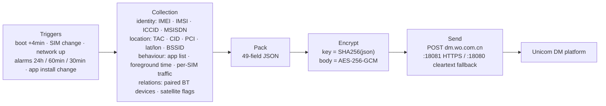

# SystemHelper

**A preinstalled "device registration" component with no UI, no off switch, and no uninstall path — what it actually collects, where it sends it, and why you cannot turn it off.**

This repository contains static-analysis results for three versions (1.2 / 3.0.1 / 4.0.0) of the Android package `com.mobiletools.systemhelper`. Every claim is traceable to a `file:line` reference in the decompiled APK. No APK and no decompiled source is redistributed here — only findings and public certificates (see [DISCLAIMER](../DISCLAIMER.md)).

*Translations: [简体中文](../README.md) · [繁體中文](README.zh-TW.md) · [日本語](README.ja.md)*

**Web version: <https://richard8695847.github.io/SystemHelper/>**

---

## At a glance

| | |
|---|---|
| Package | `com.mobiletools.systemhelper` (identical across all three versions) |
| Identity | China Unicom "terminal registration / device management" (CU-DMS) client, shipped in `priv-app`, shares a `sharedUserId` with a privileged app |
| UI | **None.** The only Activity is a debug page (`TestActivity`) |
| Consent | **No consent dialog.** The "user permission" flag reads a hard-coded `true`, or the system's `device_provisioned` (setup-wizard completion flag) |
| Opt-out | **No switch, no exit path** |
| Uninstall | `pm uninstall` removes only the per-user copy; the system-partition original returns on factory reset |
| Reported data | IMEI / IMSI / ICCID / MSISDN (1.2), cell TAC-CID-PCI, WiFi BSSID/SSID, **latitude / longitude / altitude / district / speed / bearing**, installed-app list + foreground minutes + per-SIM traffic, paired Bluetooth devices and MACs (4.0), satellite-comms flags (4.0) |
| Transport | 1.2 / 3.0.1: **cleartext HTTP** `dm.wo.com.cn:18080`; 4.0.0: HTTPS `:18081` with **automatic fallback to cleartext `:18080` whenever certificate validation fails** |
| Triggers | Boot (+4 min delay), SIM change, network connect, periodic alarms (24 h / 60 min / 30 min), app install/remove |

**Across all three versions the collection surface only grows. Users never get notice, choice, or deletion.**

---

## Data flow



The other four network endpoints found in 1.2 (`/public/ip`, `:6002/getRegisterLog`, the BONC SOAP service, and the `cnc-labs.eicp.net` dynamic-DNS host) are dead code — see [02-api-protocol.md](../docs/02-api-protocol.md).

---

## The four hard findings

**1. `sign` is not a signature — it encrypts a symmetric key with a public key**

```java
Cipher cipher = Cipher.getInstance("RSA/ECB/PKCS1Padding");
cipher.init(1, key);   // 1 = ENCRYPT_MODE, not SIGN
```

It encrypts `key = SHA256(json)` using `assets/cudms_main_pub.cer`, a public key shipped inside every APK. Anyone with the APK can produce a "valid" `sign` for arbitrary data. The chain is self-referential and provides zero authentication.

**2. AES-GCM with an IV derived from the key — identical plaintext always yields identical ciphertext**

```java
System.arraycopy(key, 0,  iv, 0, 8);    // IV[0..7]  = key[0..7]
System.arraycopy(key, 24, iv, 8, 8);    // IV[8..15] = key[24..31]
```

IV reuse under GCM is a known break (forbidden attack: recover the GHASH subkey H, then forge tags).

**3. `TrustManager` checks validity dates only — never the issuer**

```java
for (X509Certificate c : chain) c.checkValidity();   // no verify(), no pinning
```

A self-signed certificate with `SAN=dm.wo.com.cn` is enough for a full MITM.

**4. TLS failure silently downgrades to cleartext**

```
HTTPS fail by cert invalid, trigger HTTP fallback!
```

Combined with #3, any network that can break TLS (corporate WiFi, campus networks, hotspots, transparent proxies) pushes the whole channel back to plaintext — body and `sign` included.

On top of that, `model` and `manuf` travel in the query string in the clear: however well the body is encrypted, a packet capture still reveals which handset is registering.

---

## Three versions, one direction

| | 1.2 (20220907) | 3.0.1 (20260313) | 4.0.0 (20260910) |
|---|---|---|---|
| Signer | `CN=NewDM, O=CU` (self-signed, 50-year validity) | **`CN=MIUI, O=Xiaomi`** (Xiaomi platform key) | `CN=NewDM, O=CU` |
| Code | 408 readable classes, 58 vendor adapters | fully obfuscated to single-letter packages, 12 adapters | obfuscated, 13 adapters (Huawei dropped, MOTO/WIKO added) |
| Crypto | AES-ECB with MD5-derived key, RSA-1024 | unchanged | AES-256-GCM with SHA-256 key, RSA-2048 |
| Transport | cleartext HTTP | cleartext HTTP | HTTPS `:18081` + cleartext fallback |
| New collection | phone number (`MSISDN`) | Baidu location SDK; `SigInfo` drive-test fields every 30 min | paired Bluetooth devices + MACs; satellite-comms flags |
| App-list window | 7 days | 24 hours | 24 hours |
| Local queue | 100 rows | 10 rows, **delete-before-send**, 0–24 h jitter | same as 3.0.1 |

**On "anti-fraud": none of the three clients has any anti-fraud capability.** Zero hits across strings, native libraries, network endpoints and capability checks (see [03](../docs/03-compare-3.0.1.md) §10). What it does collect — precise location, cell/WiFi identifiers, app inventory, call-drop causes — happens to be ideal input for anti-fraud profiling. That is a capability question, not a feature: the client not judging does not mean the upstream does not profile.

---

## Reports

| # | Document | Contents |
|---|---|---|
| 01 | [1.2 reverse engineering](../docs/01-reverse-1.2.md) | permission model, four upload triggers, cleartext channel, local retention, four-tier remediation, fixed evidence for complaints |
| 02 | [Upload API report](../docs/02-api-protocol.md) | which of the 6 URLs are live, AES/`sign` structure, local mock verification |
| 03 | [3.0.1 comparison](../docs/03-compare-3.0.1.md) | signer change to Xiaomi, full obfuscation, Baidu location SDK, `SigInfo` fields, `MSISDN` removed |
| 04 | [4.0.0 comparison](../docs/04-compare-4.0.0.md) | three-version comparison, four genuine fixes, Bluetooth/satellite expansion, design-intent analysis (facts vs. inference kept separate) |
| 05 | [CU-DMS protocol analysis](../docs/05-cudms-protocol.md) | 49-field dictionary with sensitivity grades, four client defects, hardening advice |
| 06 | [Claim verification](../docs/06-rumor-verification.md) | item-by-item check of a Japanese thread and two Chinese sources; which claims hold, which are misattributed |
| — | [IOCs](../docs/iocs.txt) | endpoints, URLs, components, hashes, signing fingerprints |
| — | [evidence/](../evidence/) | public certificates and keys with sizes and hashes |
| — | [tools/](../tools/) | two PowerShell scripts: disable/revoke/purge/hosts-blackhole, and on-device evidence extraction |

---

## Check your own phone

```bash
# 1) present? which version?
adb shell dumpsys package com.mobiletools.systemhelper | grep versionName

# 2) are privileges actually granted?
adb shell dumpsys package com.mobiletools.systemhelper | grep granted
adb shell cmd appops get com.mobiletools.systemhelper

# 3) running? pending alarms?
adb shell ps -A | grep systemhelper
adb shell dumpsys alarm | grep systemhelper

# 4) really uploading? capture traffic filtered on dm.wo.com.cn
#    (4.0 listens on both :18080 and :18081)
```

Disable and block without root:

```bash
adb shell pm disable-user --user 0 com.mobiletools.systemhelper
adb shell pm revoke com.mobiletools.systemhelper android.permission.READ_PHONE_STATE
```

```text
# NetGuard / router hosts — blocking the domain covers both 18080 and 18081
0.0.0.0 dm.wo.com.cn
```

This works even against platform-signed components and is the only mitigation that does not depend on system privileges. Full removal requires non-carrier firmware.

---

## About paths inside the reports

Paths such as `analysis/xxx.py`, `jadx_full/sources/...` and `output/xxx.json` refer to the author's local working copy and are **not published here** (see [DISCLAIMER](../DISCLAIMER.md)). `file:line` references point into the decompilation of the corresponding APK; open the same APK with jadx to reproduce. Sample hashes:

| Version | SHA-256 |
|---|---|
| 1.2-20220907 | `416d0fc0405fc19b243e72f2a7963517e5b88991a7dfac494934449969a6015d` |
| 3.0.1-20260313 | `1de8d965e295db27e189aa179cdb45438d7f759cffbb43ce55f840b614ff6c65` |
| 4.0.0-20260910 | `42fbfebedd8711b2ca22d3d969324f7ed7c757d838e143bf6cf4d2e8e1ed8556` |

---

## Licence

Text and diagrams are released under **[CC BY 4.0](../LICENSE)**. Reuse, translation, reposting and commercial republication are all welcome — keep attribution and a link to this repository, and indicate changes.

---

## Facts vs. inference

- Fields, permissions, call chains, certificates and hashes are verifiable inside the APK: facts.
- Statements about intent and about where the data may go are explicitly marked as inference (see [04](../docs/04-compare-4.0.0.md) §5.5, with three levels of claim strength and an explicit boundary statement).
- This repository does **not** claim the dataset has been sold, shared, or used for any regulatory profiling. There is no evidence for such a claim.

If a fact is wrong, open an issue with the `file:line` reference — corrections are applied promptly. See [CONTRIBUTING](../CONTRIBUTING.md).
