# SystemHelper

**システムパーティションにプリインストールされた、UI もスイッチもアンインストール手段もない「端末登録」コンポーネント。何を集め、どこへ送り、なぜ止められないのか。**

本リポジトリは Android パッケージ `com.mobiletools.systemhelper` の 3 バージョン（1.2 / 3.0.1 / 4.0.0）の静的解析結果です。すべての結論に `ファイル:行番号` を付けており、同じ APK を jadx で開けば再現できます。**APK 本体および逆コンパイル済みソースは含みません**（理由は [DISCLAIMER](../DISCLAIMER.md)）。

*他の言語: [简体中文](../README.md) · [繁體中文](README.zh-TW.md) · [English](README.en.md)*

---

## 一目でわかる要点

| | |
|---|---|
| パッケージ | `com.mobiletools.systemhelper`（3 版共通） |
| 正体 | 中国联通の「端末登録 / デバイス管理（CU-DMS）」クライアント。`priv-app` に配置され、特権アプリと `sharedUserId` を共有 |
| UI | **皆無**。唯一の Activity はデバッグ用 `TestActivity` |
| 同意 | **同意ダイアログなし**。「ユーザー許可」が読むのは常に `true` の定数、またはシステムの `device_provisioned`（初期設定完了フラグ） |
| 停止 | **スイッチなし、終了手段なし** |
| 削除 | `pm uninstall` は現在のユーザーのコピーを消すだけ。システム側の本体は残り、初期化で復活 |
| 送信内容 | IMEI / IMSI / ICCID / 電話番号（1.2）、基地局 TAC-CID-PCI、WiFi BSSID/SSID、**緯度経度 / 標高 / 区県 / 速度 / 方位**、アプリ一覧＋前面利用時間＋SIM 別通信量、ペアリング済み Bluetooth 機器と MAC（4.0）、衛星通信フラグ（4.0） |
| 通信路 | 1.2 / 3.0.1：**平文 HTTP** `dm.wo.com.cn:18080`；4.0.0：HTTPS `:18081` だが、**証明書検証に失敗すると自動で平文 `:18080` に降格** |
| 起動条件 | 起動（4 分遅延）、SIM 変更、ネットワーク接続、定期アラーム（24h / 60min / 30min）、アプリのインストール変化 |

**3 版を通じて収集範囲は増える一方。ユーザーには告知も選択も削除も与えられない。**

---

## データの流れ

```mermaid
flowchart LR
  subgraph T["トリガー"]
    A1["起動 +4min"]:::t
    A2["SIM 変更"]:::t
    A3["ネット接続"]:::t
    A4["アラーム 24h / 60min / 30min"]:::t
    A5["アプリ変更"]:::t
  end

  subgraph C["収集"]
    D1["端末識別<br/>IMEI · IMSI · ICCID · MSISDN"]
    D2["位置と無線<br/>TAC · CID · PCI · 緯度経度 · BSSID"]
    D3["行動<br/>アプリ一覧 · 前面時間 · SIM 別通信量"]
    D4["関係と能力<br/>BT ペアリング · 衛星フラグ"]
  end

  T --> C
  C --> E["49 フィールドの JSON"]
  E --> F["key = SHA256(json)<br/>body = AES-256-GCM"]
  F --> G["POST dm.wo.com.cn<br/>:18081 HTTPS / :18080 平文フォールバック"]
  G --> H[("Unicom DM 基盤")]

  classDef t fill:#fff3cd,stroke:#d39e00,color:#000;
```



1.2 で見つかった他の 4 経路（`/public/ip`、`:6002/getRegisterLog`、BONC の SOAP、`cnc-labs.eicp.net`）はいずれもデッドコードです（[02-api-protocol.md](../docs/02-api-protocol.md)）。

---

## 特に重い 4 点

**1. `sign` は署名ではなく「公開鍵で暗号化した共通鍵」— 誰でも偽造できる**

```java
Cipher cipher = Cipher.getInstance("RSA/ECB/PKCS1Padding");
cipher.init(1, key);   // 1 = ENCRYPT_MODE（SIGN ではない）
```

APK に同梱された公開鍵 `assets/cudms_main_pub.cer` で `key = SHA256(json)` を暗号化しているだけです。鍵は平文から導出でき、`sign` は鍵から導出できる。**自己参照の閉路であり、認証としての意味はゼロ。**

**2. AES-GCM の IV を鍵から導出 → 同一平文は常に同一暗号文**

```java
System.arraycopy(key, 0,  iv, 0, 8);    // IV[0..7]  = key[0..7]
System.arraycopy(key, 24, iv, 8, 8);    // IV[8..15] = key[24..31]
```

GCM での IV 再利用は既知の破綻です（forbidden attack：認証サブ鍵 H を復元し、任意の tag を偽造可能）。

**3. `TrustManager` は有効期限しか見ず、発行者を検証しない**

```java
for (X509Certificate c : chain) c.checkValidity();   // verify() も pin もなし
```

`SAN=dm.wo.com.cn` の自己署名証明書があれば中間者攻撃が成立します。

**4. TLS 失敗時に平文へ自動降格**

```
HTTPS fail by cert invalid, trigger HTTP fallback!
```

上記 3 と組み合わせると、TLS を妨害できるネットワーク（社内 WiFi、学内網、公衆ホットスポット、透過プロキシ）は通信路全体を平文に落とせます。`body` も `sign` も丸見えです。

さらに `model` / `manuf` は query に平文で載ります。本文をどれだけ暗号化しても、パケットキャプチャで「どの機種が登録しているか」は分かります。

---

## 3 バージョン、一本の方向性

| | 1.2（20220907） | 3.0.1（20260313） | 4.0.0（20260910） |
|---|---|---|---|
| 署名主体 | `CN=NewDM, O=CU`（自社署名、有効期間 50 年） | **`CN=MIUI, O=Xiaomi`**（Xiaomi のプラットフォーム鍵） | `CN=NewDM, O=CU` |
| コード | 可読クラス 408、ベンダーアダプタ 58 | 単一文字パッケージまで完全難読化、12 | 難読化、13（Huawei を外し MOTO/WIKO を追加） |
| 暗号 | AES-ECB（鍵は MD5）、RSA-1024 | 変更なし | AES-256-GCM（鍵は SHA-256）、RSA-2048 |
| 通信 | 平文 HTTP | 平文 HTTP | HTTPS `:18081` ＋平文フォールバック |
| 追加収集 | 電話番号（`MSISDN`） | Baidu 位置 SDK、`SigInfo`（30 分ごと） | Bluetooth ペアリング機器＋MAC、衛星通信フラグ |
| アプリ一覧の周期 | 7 日 | 24 時間 | 24 時間 |
| ローカルキュー | 100 件 | 10 件、**送信前に削除**、0–24h のジッター | 3.0.1 と同じ |

**「防詐」について：3 版いずれも防詐機能はありません。** 文字列・ネイティブライブラリ・通信端点・機能の 4 層すべてゼロ件です（[03](../docs/03-compare-3.0.1.md) §10）。ただし収集されるデータ集合（精密位置＋基地局＋WiFi＋アプリ一覧＋切断理由）は**防詐プロファイリングの理想的な入力**です。これは機能ではなく能力の問題で、クライアントが判定しないことは上流が分析しないことを意味しません。

---

## レポート一覧

| # | 文書 | 内容 |
|---|---|---|
| 01 | [1.2 リバースエンジニアリング](../docs/01-reverse-1.2.md) | 権限モデル、4 つの送信トリガー、平文経路、ローカル保存、4 段階の対処、苦情用の固定証拠 |
| 02 | [送信 API レポート](../docs/02-api-protocol.md) | 6 つの URL の生死判定、AES/`sign` の構造、ローカル mock での検証 |
| 03 | [3.0.1 比較](../docs/03-compare-3.0.1.md) | 署名主体が Xiaomi へ、完全難読化、Baidu 位置 SDK、`SigInfo`、`MSISDN` の削除 |
| 04 | [4.0.0 比較](../docs/04-compare-4.0.0.md) | 3 版横断、4 つの実質的改善、Bluetooth と衛星の拡張、設計意図の分析（事実と推論を分離） |
| 05 | [CU-DMS プロトコル分析](../docs/05-cudms-protocol.md) | 49 フィールド辞書と感度分類、クライアントの 4 欠陥、強化案 |
| 06 | [外部主張の検証](../docs/06-rumor-verification.md) | 日本語スレッドと中国語 2 ソースの逐条検証、3 版差分の早見表 |
| — | [IOC リスト](../docs/iocs.txt) | 端点、URL、コンポーネント、ハッシュ、署名指紋 |
| — | [証拠添付](../evidence/) | 公開証明書と公開鍵、サイズとハッシュ |
| — | [tools/](../tools/) | PowerShell スクリプト 2 本：無効化・権限取消・データ消去・ドメイン遮断、および端末側の記録抽出 |

---

## 自分の端末を確認する

```bash
# 1) 存在するか、どのバージョンか
adb shell dumpsys package com.mobiletools.systemhelper | grep versionName

# 2) 権限が実際に付与されているか
adb shell dumpsys package com.mobiletools.systemhelper | grep granted
adb shell cmd appops get com.mobiletools.systemhelper

# 3) 動作中か、未発火のアラームがあるか
adb shell ps -A | grep systemhelper
adb shell dumpsys alarm | grep systemhelper

# 4) 本当に送信しているか：dm.wo.com.cn でフィルタしてキャプチャ
#    （4.0 は :18080 と :18081 の両方）
```

root なしでの停止と遮断：

```bash
adb shell pm disable-user --user 0 com.mobiletools.systemhelper
adb shell pm revoke com.mobiletools.systemhelper android.permission.READ_PHONE_STATE
```

```text
# NetGuard / ルータの hosts — ドメインを塞げば 18080 と 18081 の両方をカバー
0.0.0.0 dm.wo.com.cn
```

これはプラットフォーム署名されたコンポーネントにも有効で、システム権限に依存しない唯一の手段です。完全な除去は非キャリア版ファームウェアへの書き換えが必要です。

---

## 文中のパスについて

レポート内の `analysis/xxx.py`、`jadx_full/sources/...`、`output/xxx.json` は作者のローカル作業コピーを指し、**本リポジトリには含まれません**。`ファイル:行番号` は該当 APK の逆コンパイル結果を指すので、同じ APK を jadx で開けば再現できます。サンプルのハッシュ：

| バージョン | SHA-256 |
|---|---|
| 1.2-20220907 | `416d0fc0405fc19b243e72f2a7963517e5b88991a7dfac494934449969a6015d` |
| 3.0.1-20260313 | `1de8d965e295db27e189aa179cdb45438d7f759cffbb43ce55f840b614ff6c65` |
| 4.0.0-20260910 | `42fbfebedd8711b2ca22d3d969324f7ed7c757d838e143bf6cf4d2e8e1ed8556` |

---

## ライセンス

本文と図は **[CC BY 4.0](../LICENSE)** で公開します。全文転載・翻訳・再配布（商用メディアを含む）は歓迎です。著者名と本リポジトリへのリンクを残し、変更した場合はその旨を明記してください。

---

## 事実と推論

- フィールド、権限、呼び出し連鎖、証明書、ハッシュは APK 内で検証可能な**事実**です。
- 「設計意図」「データの可能な行き先」に関する記述は**推論**と明記しています（[04](../docs/04-compare-4.0.0.md) §5.5 に 3 段階の表現と境界声明）。
- 本リポジトリは、当該データセットが販売・共有・規制目的のプロファイリングに使われたと**主張しません**。そのような結論を支える証拠はありません。

事実誤認があれば `ファイル:行番号` を添えて Issue を立ててください。確認のうえ速やかに訂正します（[CONTRIBUTING](../CONTRIBUTING.md)）。
