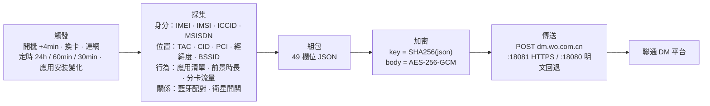

# SystemHelper

**系統分區裡預裝著一個沒有介面、沒有開關、卸載不掉的「設備註冊」元件——它到底在採集什麼、發到哪裡、為什麼關不掉。**

本倉庫是 Android 套件 `com.mobiletools.systemhelper` 三個版本（1.2 / 3.0.1 / 4.0.0）的靜態分析結果。所有結論都附 `檔案:行號`，可用 jadx 打開同一份 APK 自行複核。倉庫**不含 APK、不含反編譯原始碼**，只有分析結論與公開憑證（原因見 [DISCLAIMER](../DISCLAIMER.md)）。

*其他語言版本：[简体中文](../README.md) · [English](README.en.md) · [日本語](README.ja.md)*

---

## 一頁速覽

| | |
|---|---|
| 套件名稱 | `com.mobiletools.systemhelper`（三版一致） |
| 身分 | 中國聯通「終端註冊 / 設備管理（CU-DMS）」用戶端，預裝於 `priv-app`，與特權應用共用 `sharedUserId` |
| 介面 | **零 UI**。唯一的 Activity 是除錯頁 `TestActivity` |
| 同意 | **沒有隱私彈窗**。「使用者許可」讀到的是一個永遠為 `true` 的常數，或系統的 `device_provisioned`（開機精靈完成旗標） |
| 關閉 | **沒有開關，沒有退出入口** |
| 卸載 | `pm uninstall` 只刪除目前使用者的副本；系統分區原件仍在，恢復出廠即回歸 |
| 上報內容 | IMEI / IMSI / ICCID / 手機號（1.2）、基地台 TAC-CID-PCI、WiFi BSSID/SSID、**經緯度 / 海拔 / 區縣 / 速度 / 方位角**、應用清單 + 前景時長 + 分卡流量、藍牙配對裝置與 MAC（4.0）、衛星通訊開關（4.0） |
| 通道 | 1.2 / 3.0.1：**明文 HTTP** `dm.wo.com.cn:18080`；4.0.0：HTTPS `:18081`，但**憑證驗證失敗會自動降級回明文 `:18080`** |
| 觸發 | 開機（延遲 4 分鐘）、換卡、連網、定時鬧鐘（24h / 60min / 30min）、應用安裝變化 |

**三個版本的採樣範圍只增不減；使用者始終沒有知情權、選擇權與刪除權。**

---

## 資料怎麼流出去



另外四條外發鏈路（`/public/ip`、`:6002/getRegisterLog`、BONC SOAP、花生殼 `cnc-labs.eicp.net`）在 1.2 中都是死程式碼，詳見 [02-api-protocol.md](../docs/02-api-protocol.md)。

---

## 四個最硬的問題

**1. `sign` 不是簽章，是「用公鑰加密的對稱金鑰」——任何人都能偽造**

```java
Cipher cipher = Cipher.getInstance("RSA/ECB/PKCS1Padding");
cipher.init(1, key);   // 1 = ENCRYPT_MODE，不是 SIGN
```

加密用的是隨 APK 分發的公鑰 `assets/cudms_main_pub.cer`。`key = SHA256(json)`、`sign = RSA_pub(key)`——金鑰由明文推出，簽章由金鑰推出。**它是自我指涉的閉環，不提供任何身分保證。**

**2. AES-GCM 的 IV 由金鑰派生，同一明文永遠同一密文**

```java
System.arraycopy(key, 0,  iv, 0, 8);    // IV[0..7]  = key[0..7]
System.arraycopy(key, 24, iv, 8, 8);    // IV[8..15] = key[24..31]
```

GCM 下 IV 重用是已知的致命錯誤（forbidden attack：還原認證子金鑰 H，偽造任意 tag）。

**3. `TrustManager` 只看有效期限，不看簽發者**

```java
for (X509Certificate c : chain) c.checkValidity();   // 沒有 verify()，沒有 pin
```

自簽憑證 + `SAN=dm.wo.com.cn` 即可完成中間人攻擊。

**4. TLS 失敗就自動降級明文**

```
HTTPS fail by cert invalid, trigger HTTP fallback!
```

配合上一條：任何能攔截 TLS 的網路（企業 WiFi、校園網路、公共熱點、透明代理）都能把整條鏈路打回明文，`body` 與 `sign` 一起裸奔。

此外，`model` / `manuf` 明文放在 query 上——body 加密得再好，抓包也知道「哪款手機在向聯通註冊」。

---

## 三個版本，一條主線

| | 1.2（20220907） | 3.0.1（20260313） | 4.0.0（20260910） |
|---|---|---|---|
| 簽章主體 | `CN=NewDM, O=CU`（聯通自簽，50 年效期） | **`CN=MIUI, O=Xiaomi`**（小米平台金鑰） | `CN=NewDM, O=CU` |
| 程式碼 | 408 個可讀類別，58 家廠商轉接器 | 全量混淆為單字母套件，12 家 | 混淆，13 家（去華為、加 MOTO/WIKO） |
| 加密 | AES-ECB + MD5 金鑰，RSA-1024 | 同左，一行沒改 | AES-256-GCM + SHA-256 金鑰，RSA-2048 |
| 傳輸 | 明文 HTTP | 明文 HTTP | HTTPS `:18081` + 明文回退 |
| 新增採集 | 手機號 `MSISDN` | 百度定位 SDK、`SigInfo` 路測欄位（30 分鐘一次） | 藍牙配對裝置 + MAC、衛星通訊能力位 |
| 應用清單週期 | 7 天 | 24 小時 | 24 小時 |
| 本機佇列 | 100 筆 | 10 筆，**讀完即刪**，0–24h 隨機抖動 | 同 3.0.1 |

**關於「反詐」：三版用戶端都沒有反詐能力。** 字串、原生函式庫、網路端點、能力四層全部零命中（詳見 [03](../docs/03-compare-3.0.1.md) §10）。但它採集的資料集（精確位置 + 基地台 + WiFi + 應用清單 + 掉話原因）**恰好是反詐画像的理想輸入**——這是能力問題，不是功能問題。

---

## 報告目錄

| # | 文件 | 內容 |
|---|---|---|
| 01 | [1.2 逆向分析與根治](../docs/01-reverse-1.2.md) | 權限模型、四個上報觸發點、明文通道、本機留存、四層處置方案、可投訴的固定證據 |
| 02 | [上報介面（API）技術報告](../docs/02-api-protocol.md) | 6 個 URL 的死活判定、AES/`sign` 結構、本機 mock 閉環驗證 |
| 03 | [3.0.1 對比分析](../docs/03-compare-3.0.1.md) | 簽章換小米、全量混淆、百度定位 SDK、`SigInfo` 路測欄位、`MSISDN` 歸零 |
| 04 | [4.0.0 對比分析](../docs/04-compare-4.0.0.md) | 三版橫向、四項真實加固、藍牙與衛星擴張、設計意圖分析（事實層／推斷層分離） |
| 05 | [CU-DMS 上報協議分析](../docs/05-cudms-protocol.md) | 49 欄位字典 + 敏感度分級、用戶端四缺陷、加固建議 |
| 06 | [外部傳聞逐條核驗](../docs/06-rumor-verification.md) | 對日文帖與兩份中文來源的核驗；附三版差異速查 |
| — | [IOC 清單](../docs/iocs.txt) | 端點、URL、元件、雜湊、簽章指紋 |
| — | [證據附件](../evidence/) | 公開憑證與公鑰 + 大小/雜湊清單 |
| — | [tools/](../tools/) | 兩支 PowerShell 腳本：停用/撤權/清資料/黑洞網域、取證並解碼本機快取的上報紀錄 |

---

## 怎麼檢查自己的手機

```bash
# 1) 有沒有、什麼版本
adb shell dumpsys package com.mobiletools.systemhelper | grep versionName

# 2) 權限是否真的被授予
adb shell dumpsys package com.mobiletools.systemhelper | grep granted
adb shell cmd appops get com.mobiletools.systemhelper

# 3) 是否在跑、是否有待觸發的鬧鐘
adb shell ps -A | grep systemhelper
adb shell dumpsys alarm | grep systemhelper

# 4) 是否真的在上報：抓包過濾 dm.wo.com.cn（4.0 注意 :18080 與 :18081）
```

停用與攔截（不需要 root）：

```bash
adb shell pm disable-user --user 0 com.mobiletools.systemhelper
adb shell pm revoke com.mobiletools.systemhelper android.permission.READ_PHONE_STATE
```

```text
# NetGuard / 路由器 hosts：黑洞這個網域即可覆蓋 18080 與 18081
0.0.0.0 dm.wo.com.cn
```

**這一步對平台簽章的元件同樣有效**，也是唯一不依賴系統授權的手段。徹底清除只能刷非客製化韌體。

---

## 關於文內路徑

報告中的 `analysis/xxx.py`、`jadx_full/sources/...`、`output/xxx.json` 指作者本機工作副本，**未隨倉庫發布**。`檔案:行號` 指向對應 APK 的反編譯結果，用 jadx 打開同一份 APK 即可複現。樣本雜湊：

| 版本 | SHA-256 |
|---|---|
| 1.2-20220907 | `416d0fc0405fc19b243e72f2a7963517e5b88991a7dfac494934449969a6015d` |
| 3.0.1-20260313 | `1de8d965e295db27e189aa179cdb45438d7f759cffbb43ce55f840b614ff6c65` |
| 4.0.0-20260910 | `42fbfebedd8711b2ca22d3d969324f7ed7c757d838e143bf6cf4d2e8e1ed8556` |

---

## 授權

本倉庫文字與圖表以 **[CC BY 4.0](../LICENSE)** 釋出，**歡迎全文轉載、翻譯、二次散布**，包括商業媒體——只需保留作者署名與本倉庫連結，並註明是否修改。

---

## 事實與推斷

- 欄位、權限、呼叫鏈、憑證、雜湊均可在 APK 內逐條驗證，屬於事實。
- 關於「設計意圖」「資料可能去向」的判斷已明確標註為**推斷**（見 [04](../docs/04-compare-4.0.0.md) §5.5 的三檔表述與邊界聲明）。
- 本倉庫**不主張**該資料集已被出售、共享或用於任何監管画像；沒有證據支持這類結論。

發現事實錯誤請開 Issue 並附上 `檔案:行號`，核實後立即更正，見 [CONTRIBUTING](../CONTRIBUTING.md)。
